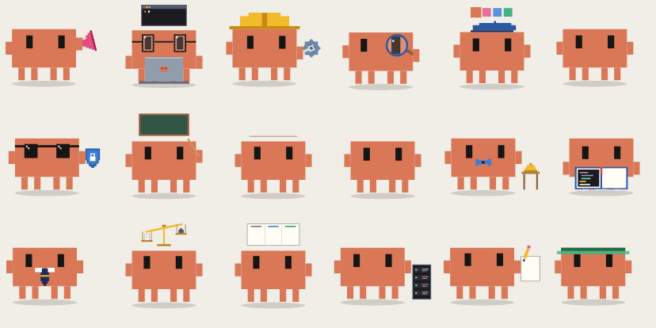

<h1 align="center">Lottie Clawd</h1>

<p align="center">
  <b>27 Clawds. Each one has a job, a prop and a loop.</b><br>
  Small Lottie files. No build step.
</p>

<p align="center">
  <a href="https://bmeunier1974.github.io/lottie-clawd/">
    
  </a>
</p>

<p align="center">
  <a href="https://bmeunier1974.github.io/lottie-clawd/"><b>See all 27 move →</b></a>
</p>

---

## Want a new Clawd? Ask Claude.

This is the fastest way to add one. Open this repo in [Claude Code](https://claude.com/claude-code). Copy the prompt. Change the first line. Send it.

```text
Make these new Clawds for this repo: pirate, astronaut, barista.

Clawd is the pixel crab mascot of Claude Code. Each Clawd in this repo is a
Lottie animation with its own props and its own loop. I want the new ones to
look like they belong to the same family as the 27 that are already here.

How the repo works
- index.html reads animations/manifest.json and plays each file with
  lottie-web. There is no build step. GitHub Pages serves main, so a push to
  main publishes the page.
- tools/make_role_clawds.py holds the parts of Clawd (body, eyes, arms, legs,
  shadow) and the shape and keyframe helpers.
- tools/make_job_clawds.py imports those helpers. It has one function for
  each Clawd. Read both scripts before you write anything.

What to make
1. Write a new script, tools/make_<theme>_clawds.py. Import the helpers the
   same way make_job_clawds.py does. Write one function for each Clawd.
   Do not write Lottie JSON by hand.
2. The script writes animations/clawd-<name>.json for each Clawd.
3. Add one entry for each Clawd to animations/manifest.json: file, name, and
   a description of one short sentence.

What makes a good Clawd
- Stage 512 x 512, 30 frames per second, a loop of 60, 90 or 120 frames.
  Every value at the last frame equals its value at the first frame, so the
  loop has no jump.
- Clawd does not change: body 300 x 180, parts 30 x 60, color #D97757, the
  same size as the others. If a prop needs room, move the rig sideways. Do
  not make Clawd smaller.
- Flat rectangles on the pixel grid. No gradients.
- One prop or one thing to wear that names the job at a glance.
- One small story in the loop: something happens, Clawd reacts, it resets.
- Every color must be clear on both stage colors, #f0eee6 (light) and
  #3a3835 (dark). The page follows the system theme.
- Everything stays inside the stage. A Clawd with a prop above its head must
  not hop into the prop.

Check your work before you push
- Render several frames of each new Clawd in a browser, on both stage
  colors, and look at them. lottie-web's goToAndStop(frame, true) in headless
  Chrome works well. Fix what looks wrong, then look one more time.
- Serve the folder with "python3 -m http.server" and confirm that the page
  loads every Clawd.

Then commit and push to main. If you cannot push, open a pull request.
Tell me which Clawds you added and what you could not check.
```

Not your repo? Fork it first. Claude opens a pull request.

---

## The cast

**The first one** · Clawd says hi

**Roles** · Admin · Accountant · Marketing · CEO · Coder · Engineer

**Jobs an AI can do** · Researcher · Writer · Editor · Translator · Data Analyst · QA Tester · Code Reviewer · Support Agent · Sales Rep · Recruiter · Legal Reviewer · Project Manager · Product Manager · Designer · Security Analyst · DevOps · Technical Writer · Social Media Manager · Assistant · Tutor

## Use a Clawd on your page

Each card on [the page](https://bmeunier1974.github.io/lottie-clawd/) has a link to its Lottie file. You can also load a file from here:

```html
<div id="clawd" style="width: 240px; height: 240px"></div>
<script src="https://cdnjs.cloudflare.com/ajax/libs/lottie-web/5.12.2/lottie.min.js"></script>
<script>
  lottie.loadAnimation({
    container: document.getElementById('clawd'),
    renderer: 'svg',
    loop: true,
    autoplay: true,
    path: 'https://bmeunier1974.github.io/lottie-clawd/animations/clawd-coder.json',
  });
</script>
```

The files are small: 9 KB to 31 KB each. The background is transparent.

## Add a Clawd by hand

1. Put the Lottie file in `animations/`. Example: `animations/clawd-pirate.json`.
2. Add one entry to `animations/manifest.json`:

   ```json
   {
     "file": "clawd-pirate.json",
     "name": "Pirate Clawd",
     "description": "Clawd with a hat and a patch."
   }
   ```

3. Commit and push to `main`. GitHub Pages publishes the page again.

## Change a Clawd

Two scripts make 26 of the 27 files. Change a script, then run it. It writes its files in `animations/` again.

| Script | What it makes |
|---|---|
| `python3 tools/make_role_clawds.py` | The six roles. It also holds the parts of Clawd and the helpers. |
| `python3 tools/make_job_clawds.py` | The 20 jobs. The list is `JOBS`, at the end of the script. |

## See the page on your machine

```sh
python3 -m http.server 8000
```

Then open http://localhost:8000/. The page does not work from a `file://` address, because the browser blocks `fetch` there.

## How it works

- `index.html` reads `animations/manifest.json` and makes one card for each entry.
- [lottie-web](https://github.com/airbnb/lottie-web) 5.12.2 plays the files. It loads from cdnjs.
- There is no build step. GitHub Pages serves `main` from the root folder.

---

<p align="center">Clawd is the mascot of Claude Code, by Anthropic. This is a fan project.</p>
